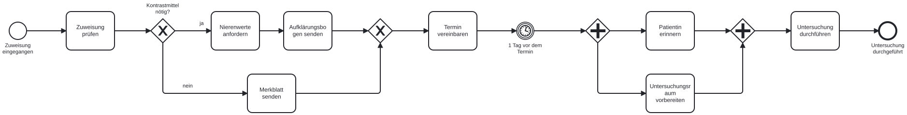

# EB-Q3-5: Untersuchung in der Radiologie

Basic-Prüfung, Q3, Version E · 12 Punkte · 20 Minuten · Branche: health

## Aufgabe

Eine radiologische Praxis erhält Zuweisungen von Hausärztinnen. Ist eine Zuweisung eingegangen, prüft das Sekretariat sie. Ist ein Kontrastmittel nötig, fordert das Sekretariat die Nierenwerte bei der Hausärztin an und sendet danach den Aufklärungsbogen an die Patientin. Andernfalls sendet es ein Merkblatt. Anschliessend vereinbart das Sekretariat den Termin. Einen Tag vor dem Termin erinnert das Sekretariat die Patientin, während die Fachperson Radiologie gleichzeitig den Untersuchungsraum vorbereitet. Sind beide Arbeiten erledigt, führt die Fachperson Radiologie die Untersuchung durch. Damit ist die Untersuchung durchgeführt. Modellieren Sie den Ablauf. Rollen müssen nicht dargestellt werden.

## Lösung

BPMN: [solution.de.bpmn](solution.de.bpmn)

## Bewertung

| Punkte | Bewertung |
|---|---|
| 1 | Startereignis als Zustand benannt |
| 1 | Endereignis als Ergebnis benannt |
| 1 | Alle Aktivitäten als Objekt und Verb benannt |
| 2 | XOR-Split mit Frage «Kontrastmittel nötig?» und Ausgängen ja/nein |
| 1 | XOR-Merge vor dem weiteren Ablauf |
| 2 | Zwischenereignis (Zeit) «1 Tag vor dem Termin» an der richtigen Stelle |
| 2 | AND-Split und AND-Join um die beiden gleichzeitigen Arbeiten |
| 2 | Reihenfolge aller Schritte wie im Text |
