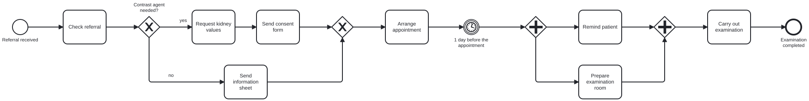

# EB-Q3-5: Radiology examination

Basic exam, Q3, Version E · 12 points · 20 minutes · Industry: health

## Task

A radiology practice receives referrals from general practitioners. When a referral has been received, the front office checks it. If a contrast agent is needed, the front office requests the kidney values from the general practitioner and then sends the consent form to the patient. Otherwise it sends an information sheet. The front office then arranges the appointment. One day before the appointment, the front office reminds the patient while the radiographer prepares the examination room at the same time. When both are done, the radiographer carries out the examination. The examination is then completed. Model the process. Roles do not need to be shown.

## Solution

BPMN: [solution.en.bpmn](solution.en.bpmn)

## Scoring

| points | Scoring |
|---|---|
| 1 | Start event named as a state |
| 1 | End event named as the result |
| 1 | All activities named as verb and object |
| 2 | XOR split with question "Contrast agent needed?" and yes/no flows |
| 1 | XOR merge before the process continues |
| 2 | Intermediate timer event "1 day before the appointment" at the right place |
| 2 | AND split and AND join around the two concurrent tasks |
| 2 | Order of all steps as in the text |
