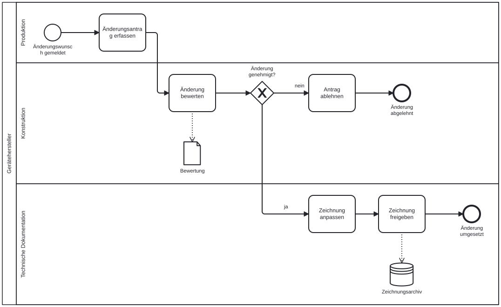

# EB-Q4-1: Technische Änderung

Basic-Prüfung, Q4, Version A · 12 Punkte · 20 Minuten · Branche: production

## Aufgabe

Bei einem Hersteller von Messgeräten kann die Produktion Änderungen an Bauteilen anregen. Ist ein Änderungswunsch gemeldet, erfasst die Produktion den Änderungsantrag. Die Konstruktion bewertet danach die Änderung und hält das Ergebnis in einer Bewertung fest. Genehmigt die Konstruktion die Änderung nicht, lehnt sie den Antrag ab, und die Änderung ist abgelehnt. Genehmigt sie die Änderung, passt die technische Dokumentation die Zeichnung an und gibt sie danach im Zeichnungsarchiv frei. Damit ist die Änderung umgesetzt. Modellieren Sie den Ablauf im Pool «Gerätehersteller» mit einer Lane pro Rolle. Stellen Sie die Bewertung als Datenobjekt mit Zustand und das Zeichnungsarchiv als Datenspeicher dar.

## Lösung

BPMN: [solution.de.bpmn](solution.de.bpmn)

## Bewertung

| Punkte | Bewertung |
|---|---|
| 2 | Pool «Gerätehersteller» mit den drei Lanes «Produktion», «Konstruktion», «Technische Dokumentation» |
| 3 | Jede Aktivität in der Lane der zuständigen Rolle |
| 1 | Startereignis als Zustand benannt |
| 1 | XOR-Split mit Frage «Änderung genehmigt?» und Ausgängen ja/nein |
| 1 | Zwei Endereignisse für die zwei Ergebnisse |
| 2 | Datenobjekt «Bewertung» mit Zustand [erstellt], ausgehende Assoziation von «Änderung bewerten» |
| 2 | Datenspeicher «Zeichnungsarchiv» mit Assoziation von «Zeichnung freigeben» |
