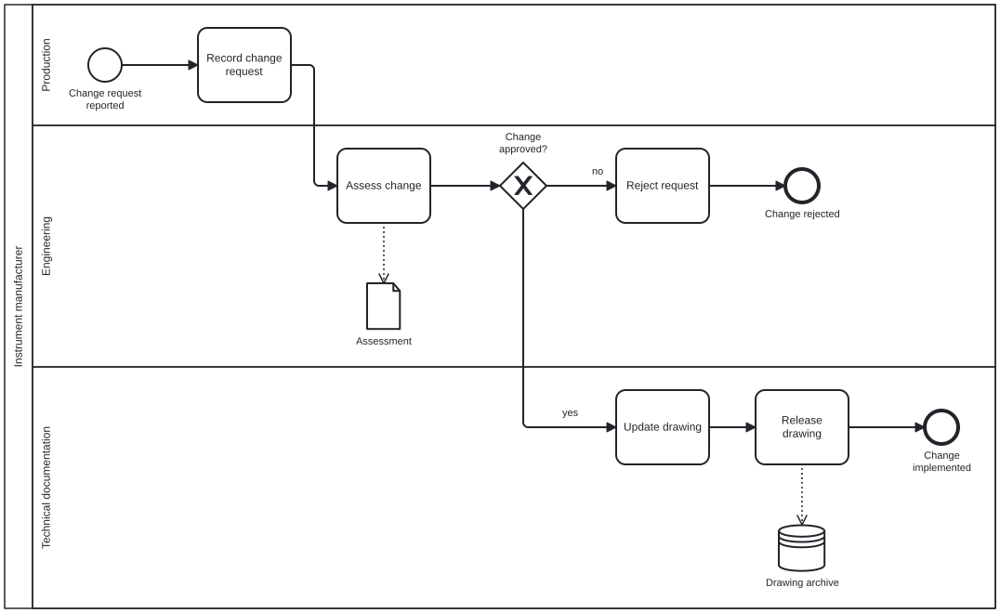

# EB-Q4-1: Engineering change

Basic exam, Q4, Version A · 12 points · 20 minutes · Industry: production

## Task

At a manufacturer of measuring instruments, production can propose changes to components. When a change request has been reported, production records the change request. Engineering then assesses the change and records the result in an assessment. If engineering does not approve the change, it rejects the request and the change is rejected. If it approves the change, technical documentation updates the drawing and then releases it in the drawing archive. The change is then implemented. Model the process in the pool "Instrument manufacturer" with one lane per role. Show the assessment as a data object with a state and the drawing archive as a data store.

## Solution

BPMN: [solution.en.bpmn](solution.en.bpmn)

## Scoring

| points | Scoring |
|---|---|
| 2 | Pool "Instrument manufacturer" with the three lanes "Production", "Engineering", "Technical documentation" |
| 3 | Every activity in the lane of the responsible role |
| 1 | Start event named as a state |
| 1 | XOR split with question "Change approved?" and yes/no flows |
| 1 | Two end events for the two results |
| 2 | Data object "Assessment" with state [created], output association from "Assess change" |
| 2 | Data store "Drawing archive" with association from "Release drawing" |
