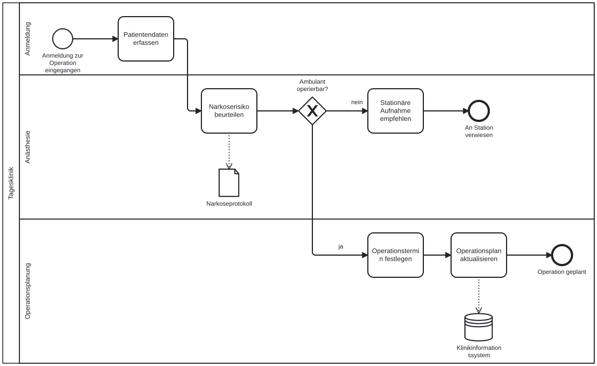

# EB-Q4-2: Anmeldung in der Tagesklinik

Basic-Prüfung, Q4, Version B · 12 Punkte · 20 Minuten · Branche: health

## Aufgabe

Eine Tagesklinik führt ambulante Operationen durch. Ist eine Anmeldung zur Operation eingegangen, erfasst die Anmeldung die Patientendaten. Die Anästhesie beurteilt danach das Narkoserisiko und füllt dabei das Narkoseprotokoll aus. Ist die Patientin nicht ambulant operierbar, empfiehlt die Anästhesie eine stationäre Aufnahme, und die Patientin ist an die Station verwiesen. Andernfalls legt die Operationsplanung den Operationstermin fest und aktualisiert danach den Operationsplan im Klinikinformationssystem. Damit ist die Operation geplant. Modellieren Sie den Ablauf im Pool «Tagesklinik» mit einer Lane pro Rolle. Stellen Sie das Narkoseprotokoll als Datenobjekt mit Zustand und das Klinikinformationssystem als Datenspeicher dar.

## Lösung

BPMN: [solution.de.bpmn](solution.de.bpmn)

## Bewertung

| Punkte | Bewertung |
|---|---|
| 2 | Pool «Tagesklinik» mit den drei Lanes «Anmeldung», «Anästhesie», «Operationsplanung» |
| 3 | Jede Aktivität in der Lane der zuständigen Rolle |
| 1 | Startereignis als Zustand benannt |
| 1 | XOR-Split mit Frage «Ambulant operierbar?» und Ausgängen ja/nein |
| 1 | Zwei Endereignisse für die zwei Ergebnisse |
| 2 | Datenobjekt «Narkoseprotokoll» mit Zustand [ausgefüllt], ausgehende Assoziation von «Narkoserisiko beurteilen» |
| 2 | Datenspeicher «Klinikinformationssystem» mit Assoziation von «Operationsplan aktualisieren» |
