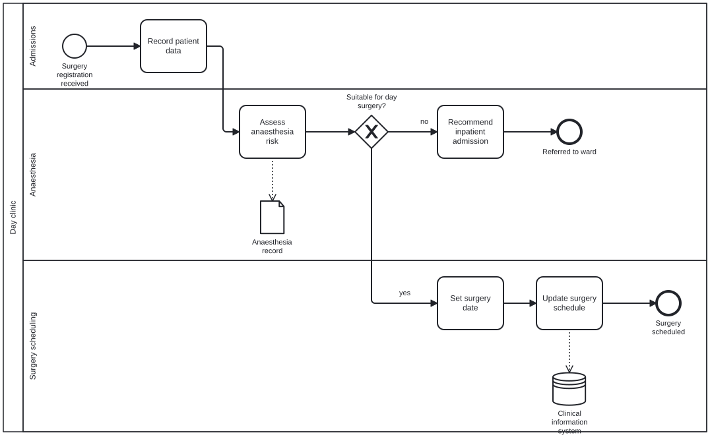

# EB-Q4-2: Admission to a day clinic

Basic exam, Q4, Version B · 12 points · 20 minutes · Industry: health

## Task

A day clinic carries out outpatient surgery. When a registration for surgery has been received, admissions records the patient data. Anaesthesia then assesses the anaesthesia risk and completes the anaesthesia record. If the patient is not suitable for day surgery, anaesthesia recommends inpatient admission and the patient is referred to the ward. Otherwise surgery scheduling sets the surgery date and then updates the surgery schedule in the clinical information system. The surgery is then scheduled. Model the process in the pool "Day clinic" with one lane per role. Show the anaesthesia record as a data object with a state and the clinical information system as a data store.

## Solution

BPMN: [solution.en.bpmn](solution.en.bpmn)

## Scoring

| points | Scoring |
|---|---|
| 2 | Pool "Day clinic" with the three lanes "Admissions", "Anaesthesia", "Surgery scheduling" |
| 3 | Every activity in the lane of the responsible role |
| 1 | Start event named as a state |
| 1 | XOR split with question "Suitable for day surgery?" and yes/no flows |
| 1 | Two end events for the two results |
| 2 | Data object "Anaesthesia record" with state [completed], output association from "Assess anaesthesia risk" |
| 2 | Data store "Clinical information system" with association from "Update surgery schedule" |
