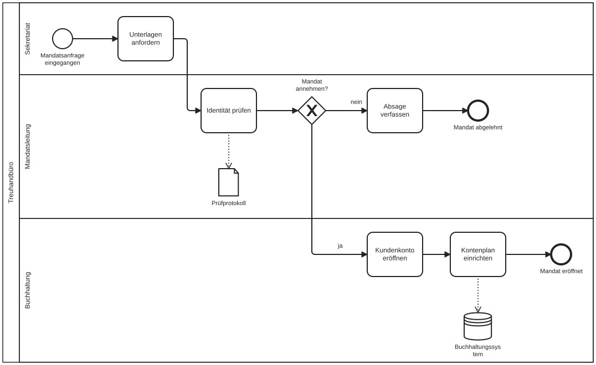

# EB-Q4-3: Neues Mandat im Treuhandbüro

Basic-Prüfung, Q4, Version C · 12 Punkte · 20 Minuten · Branche: services

## Aufgabe

Ein Treuhandbüro übernimmt die Buchhaltung von kleinen Unternehmen. Ist eine Mandatsanfrage eingegangen, fordert das Sekretariat die Unterlagen an. Die Mandatsleitung prüft danach die Identität der Kundschaft und hält das Ergebnis in einem Prüfprotokoll fest. Nimmt die Mandatsleitung das Mandat nicht an, verfasst sie eine Absage, und das Mandat ist abgelehnt. Andernfalls eröffnet die Buchhaltung ein Kundenkonto und richtet danach den Kontenplan im Buchhaltungssystem ein. Damit ist das Mandat eröffnet. Modellieren Sie den Ablauf im Pool «Treuhandbüro» mit einer Lane pro Rolle. Stellen Sie das Prüfprotokoll als Datenobjekt mit Zustand und das Buchhaltungssystem als Datenspeicher dar.

## Lösung

BPMN: [solution.de.bpmn](solution.de.bpmn)

## Bewertung

| Punkte | Bewertung |
|---|---|
| 2 | Pool «Treuhandbüro» mit den drei Lanes «Sekretariat», «Mandatsleitung», «Buchhaltung» |
| 3 | Jede Aktivität in der Lane der zuständigen Rolle |
| 1 | Startereignis als Zustand benannt |
| 1 | XOR-Split mit Frage «Mandat annehmen?» und Ausgängen ja/nein |
| 1 | Zwei Endereignisse für die zwei Ergebnisse |
| 2 | Datenobjekt «Prüfprotokoll» mit Zustand [abgeschlossen], ausgehende Assoziation von «Identität prüfen» |
| 2 | Datenspeicher «Buchhaltungssystem» mit Assoziation von «Kontenplan einrichten» |
