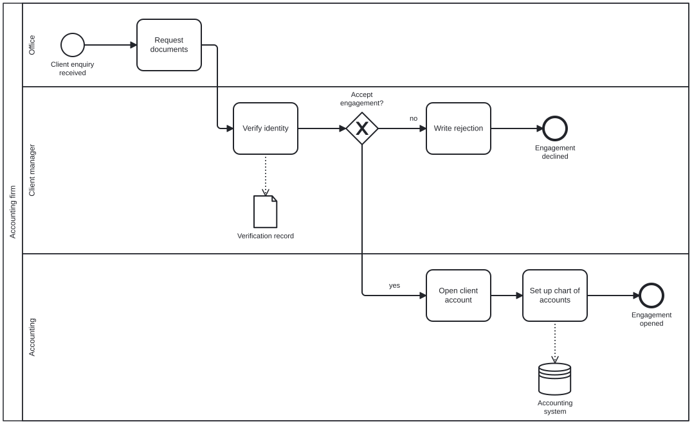

# EB-Q4-3: New client at an accounting firm

Basic exam, Q4, Version C · 12 points · 20 minutes · Industry: services

## Task

An accounting firm keeps the books of small companies. When a client enquiry has been received, the office requests the documents. The client manager then verifies the client's identity and records the result in a verification record. If the client manager does not accept the engagement, she writes a rejection and the engagement is declined. Otherwise accounting opens a client account and then sets up the chart of accounts in the accounting system. The engagement is then opened. Model the process in the pool "Accounting firm" with one lane per role. Show the verification record as a data object with a state and the accounting system as a data store.

## Solution

BPMN: [solution.en.bpmn](solution.en.bpmn)

## Scoring

| points | Scoring |
|---|---|
| 2 | Pool "Accounting firm" with the three lanes "Office", "Client manager", "Accounting" |
| 3 | Every activity in the lane of the responsible role |
| 1 | Start event named as a state |
| 1 | XOR split with question "Accept engagement?" and yes/no flows |
| 1 | Two end events for the two results |
| 2 | Data object "Verification record" with state [completed], output association from "Verify identity" |
| 2 | Data store "Accounting system" with association from "Set up chart of accounts" |
