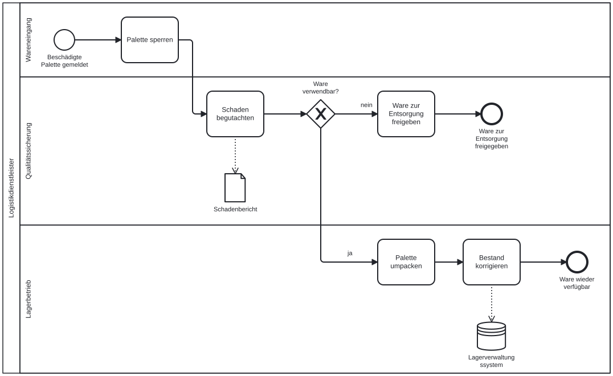

# EB-Q4-4: Beschädigte Palette

Basic-Prüfung, Q4, Version D · 12 Punkte · 20 Minuten · Branche: supply chain

## Aufgabe

Ein Logistikdienstleister lagert Ware für Industriekunden. Meldet ein Lagermitarbeiter eine beschädigte Palette, sperrt der Wareneingang die Palette. Die Qualitätssicherung begutachtet danach den Schaden und erstellt dazu einen Schadenbericht. Ist die Ware nicht mehr verwendbar, gibt die Qualitätssicherung sie zur Entsorgung frei. Andernfalls packt der Lagerbetrieb die Palette um und korrigiert danach den Bestand im Lagerverwaltungssystem. Damit ist die Ware wieder verfügbar. Modellieren Sie den Ablauf im Pool «Logistikdienstleister» mit einer Lane pro Rolle. Stellen Sie den Schadenbericht als Datenobjekt mit Zustand und das Lagerverwaltungssystem als Datenspeicher dar.

## Lösung

BPMN: [solution.de.bpmn](solution.de.bpmn)

## Bewertung

| Punkte | Bewertung |
|---|---|
| 2 | Pool «Logistikdienstleister» mit den drei Lanes «Wareneingang», «Qualitätssicherung», «Lagerbetrieb» |
| 3 | Jede Aktivität in der Lane der zuständigen Rolle |
| 1 | Startereignis als Zustand benannt |
| 1 | XOR-Split mit Frage «Ware verwendbar?» und Ausgängen ja/nein |
| 1 | Zwei Endereignisse für die zwei Ergebnisse |
| 2 | Datenobjekt «Schadenbericht» mit Zustand [erstellt], ausgehende Assoziation von «Schaden begutachten» |
| 2 | Datenspeicher «Lagerverwaltungssystem» mit Assoziation von «Bestand korrigieren» |
