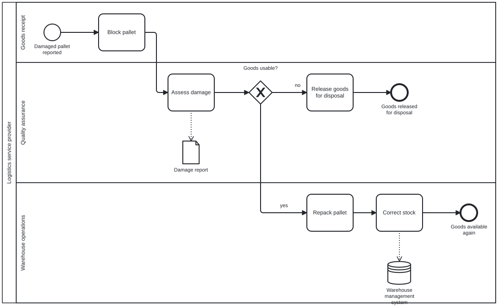

# EB-Q4-4: Damaged pallet

Basic exam, Q4, Version D · 12 points · 20 minutes · Industry: supply chain

## Task

A logistics service provider stores goods for industrial customers. When a warehouse employee reports a damaged pallet, goods receipt blocks the pallet. Quality assurance then assesses the damage and creates a damage report. If the goods can no longer be used, quality assurance releases them for disposal. Otherwise warehouse operations repacks the pallet and then corrects the stock in the warehouse management system. The goods are then available again. Model the process in the pool "Logistics service provider" with one lane per role. Show the damage report as a data object with a state and the warehouse management system as a data store.

## Solution

BPMN: [solution.en.bpmn](solution.en.bpmn)

## Scoring

| points | Scoring |
|---|---|
| 2 | Pool "Logistics service provider" with the three lanes "Goods receipt", "Quality assurance", "Warehouse operations" |
| 3 | Every activity in the lane of the responsible role |
| 1 | Start event named as a state |
| 1 | XOR split with question "Goods usable?" and yes/no flows |
| 1 | Two end events for the two results |
| 2 | Data object "Damage report" with state [created], output association from "Assess damage" |
| 2 | Data store "Warehouse management system" with association from "Correct stock" |
