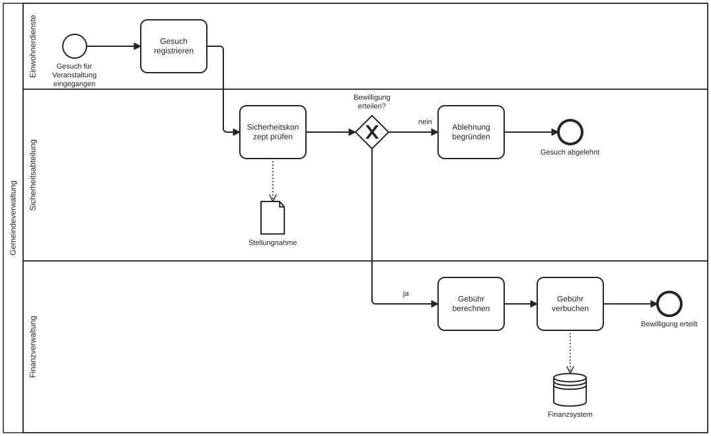

# EB-Q4-5: Bewilligung für eine Veranstaltung

Basic-Prüfung, Q4, Version E · 12 Punkte · 20 Minuten · Branche: public administration

## Aufgabe

Eine Gemeinde bewilligt Veranstaltungen auf öffentlichem Grund. Ist ein Gesuch eingegangen, registrieren die Einwohnerdienste das Gesuch. Die Sicherheitsabteilung prüft danach das Sicherheitskonzept und verfasst dazu eine Stellungnahme. Erteilt die Sicherheitsabteilung die Bewilligung nicht, begründet sie die Ablehnung, und das Gesuch ist abgelehnt. Andernfalls berechnet die Finanzverwaltung die Gebühr und verbucht sie danach im Finanzsystem. Damit ist die Bewilligung erteilt. Modellieren Sie den Ablauf im Pool «Gemeindeverwaltung» mit einer Lane pro Rolle. Stellen Sie die Stellungnahme als Datenobjekt mit Zustand und das Finanzsystem als Datenspeicher dar.

## Lösung

BPMN: [solution.de.bpmn](solution.de.bpmn)

## Bewertung

| Punkte | Bewertung |
|---|---|
| 2 | Pool «Gemeindeverwaltung» mit den drei Lanes «Einwohnerdienste», «Sicherheitsabteilung», «Finanzverwaltung» |
| 3 | Jede Aktivität in der Lane der zuständigen Rolle |
| 1 | Startereignis als Zustand benannt |
| 1 | XOR-Split mit Frage «Bewilligung erteilen?» und Ausgängen ja/nein |
| 1 | Zwei Endereignisse für die zwei Ergebnisse |
| 2 | Datenobjekt «Stellungnahme» mit Zustand [verfasst], ausgehende Assoziation von «Sicherheitskonzept prüfen» |
| 2 | Datenspeicher «Finanzsystem» mit Assoziation von «Gebühr verbuchen» |
