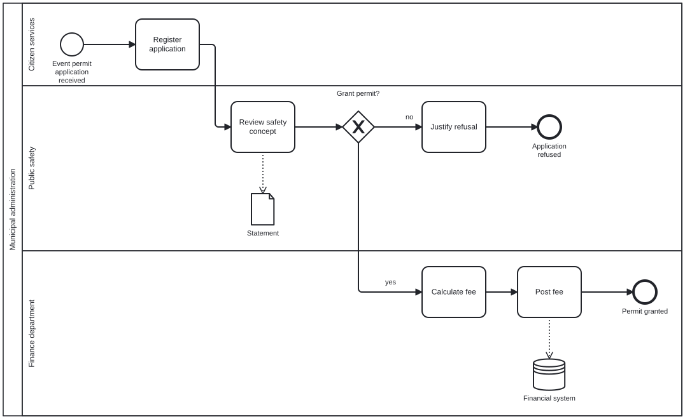

# EB-Q4-5: Event permit

Basic exam, Q4, Version E · 12 points · 20 minutes · Industry: public administration

## Task

A municipality grants permits for events on public ground. When an application has been received, citizen services registers it. Public safety then reviews the safety concept and writes a statement. If public safety does not grant the permit, it justifies the refusal and the application is refused. Otherwise the finance department calculates the fee and then posts it in the financial system. The permit is then granted. Model the process in the pool "Municipal administration" with one lane per role. Show the statement as a data object with a state and the financial system as a data store.

## Solution

BPMN: [solution.en.bpmn](solution.en.bpmn)

## Scoring

| points | Scoring |
|---|---|
| 2 | Pool "Municipal administration" with the three lanes "Citizen services", "Public safety", "Finance department" |
| 3 | Every activity in the lane of the responsible role |
| 1 | Start event named as a state |
| 1 | XOR split with question "Grant permit?" and yes/no flows |
| 1 | Two end events for the two results |
| 2 | Data object "Statement" with state [written], output association from "Review safety concept" |
| 2 | Data store "Financial system" with association from "Post fee" |
