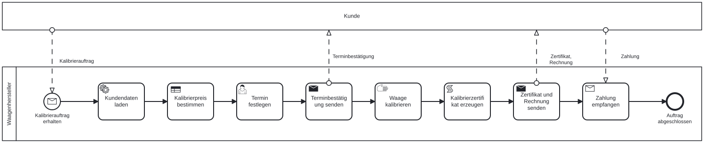

# T1-A Kalibrierauftrag für eine Industriewaage

Thema 1: Aktivitäten, Fortgeschritten | Zeit: 15 Minuten

## Aufgabe

Ein Hersteller von Industriewaagen kalibriert Waagen bei seinen Kunden. Der Ablauf beginnt, wenn ein Kunde einen Kalibrierauftrag sendet. Das CRM-System lädt automatisch die Kundendaten. Der Preis ergibt sich aus der Tariftabelle nach Waagentyp und Messbereich. Eine Disponentin legt im Planungssystem einen Termin fest; danach sendet der Hersteller dem Kunden die Terminbestätigung. Ein Servicetechniker kalibriert die Waage vor Ort von Hand, ohne IT-Unterstützung. Aus den Messwerten erzeugt ein Skript automatisch das Kalibrierzertifikat. Der Hersteller sendet dem Kunden Zertifikat und Rechnung und wartet dann auf die Zahlung. Mit dem Zahlungseingang ist der Auftrag abgeschlossen. Modellieren Sie den Ablauf des Herstellers mit den passenden Aufgabentypen; der Kunde ist ein zugeklappter Pool.

## Lernziel

Den passenden Aufgabentyp wählen: Benutzer-, Service-, Geschäftsregel-, Sende-, Empfangs-, manuelle und Skriptaufgabe.

Elemente: task types (user, service, manual, script, business rule, send, receive), subprocess, call activity, ad-hoc subprocess, loop and multi-instance markers (parallel, sequential)

## Musterlösung

BPMN: [solution.de.bpmn](solution.de.bpmn)

## Typische Fehler

- Alle Aktivitäten als einfache Aufgaben ohne Typ.
- Tarif bestimmen als Benutzeraufgabe statt Geschäftsregelaufgabe.
- Warten auf die Zahlung als Benutzeraufgabe statt Empfangsaufgabe.

---
Lizenz: CC BY 4.0
