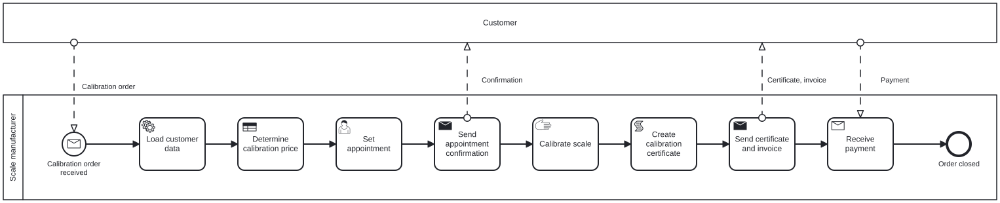

# T1-A Calibration order for an industrial scale

Topic 1: Activities, Advanced | Time: 15 minutes

## Task

A manufacturer of industrial scales calibrates scales at its customers' sites. The process starts when a customer sends a calibration order. The CRM system loads the customer data automatically. The price follows from the rate table by scale type and measuring range. A dispatcher sets an appointment in the planning system; the manufacturer then sends the appointment confirmation to the customer. A service technician calibrates the scale on site by hand, without IT support. A script creates the calibration certificate automatically from the measurements. The manufacturer sends the certificate and invoice to the customer and then waits for the payment. When the payment has arrived, the order is closed. Model the manufacturer's process with the matching task types; the customer is a collapsed pool.

## Learning goal

Choose the matching task type: user, service, business rule, send, receive, manual and script task.

Elements: task types (user, service, manual, script, business rule, send, receive), subprocess, call activity, ad-hoc subprocess, loop and multi-instance markers (parallel, sequential)

## Sample solution

BPMN: [solution.en.bpmn](solution.en.bpmn)

## Typical mistakes

- All activities as plain tasks without a type.
- Determining the price as a user task instead of a business rule task.
- Waiting for payment as a user task instead of a receive task.

---
Licence: CC BY 4.0
