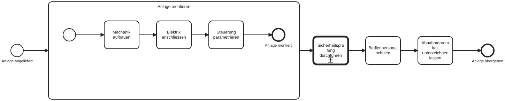

# T1-A2 Abfüllanlage beim Kunden in Betrieb nehmen

Thema 1: Aktivitäten, Fortgeschritten | Zeit: 15 Minuten

## Aufgabe

Ein Hersteller von Abfüllanlagen nimmt seine Anlagen beim Kunden in Betrieb. Der Ablauf beginnt, wenn die Anlage beim Kunden angeliefert ist. Zuerst montiert das Montageteam die Anlage: Es baut die Mechanik auf, schliesst die Elektrik an und parametriert die Steuerung. Danach führt ein Sicherheitsingenieur die Sicherheitsprüfung durch. Die Sicherheitsprüfung ist ein eigener, firmenweit einheitlicher Prozess, den auch andere Abläufe verwenden; ihre Schritte werden hier nicht modelliert. Anschliessend schult das Team das Bedienpersonal und lässt das Abnahmeprotokoll vom Kunden unterzeichnen. Damit ist die Anlage übergeben. Modellieren Sie die Montage als aufgeklappten Teilprozess.

## Lernziel

Einen Ablauf mit einem Teilprozess gliedern und einen wiederverwendeten Prozess als Aufrufaktivität einbinden.

Elemente: task types (user, service, manual, script, business rule, send, receive), subprocess, call activity, ad-hoc subprocess, loop and multi-instance markers (parallel, sequential)

## Musterlösung

BPMN: [solution.de.bpmn](solution.de.bpmn)

## Typische Fehler

- Sicherheitsprüfung als normaler Teilprozess statt Aufrufaktivität.
- Montageschritte ohne Teilprozess direkt im Hauptablauf.
- Teilprozess ohne eigenes Start- und Endereignis.

---
Lizenz: CC BY 4.0
