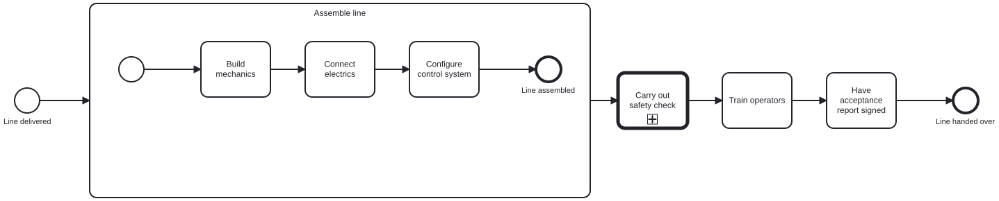

# T1-A2 Commissioning a filling line at the customer

Topic 1: Activities, Advanced | Time: 15 minutes

## Task

A manufacturer of filling lines commissions its lines at the customer's plant. The process starts when the line has been delivered to the customer. First the assembly team assembles the line: it builds the mechanics, connects the electrics and configures the control system. A safety engineer then carries out the safety check. The safety check is a separate company-wide process that other processes use as well; its steps are not modelled here. The team then trains the operators and has the customer sign the acceptance report. The line is then handed over. Model the assembly as an expanded subprocess.

## Learning goal

Structure a process with a subprocess and include a reused process as a call activity.

Elements: task types (user, service, manual, script, business rule, send, receive), subprocess, call activity, ad-hoc subprocess, loop and multi-instance markers (parallel, sequential)

## Sample solution

BPMN: [solution.en.bpmn](solution.en.bpmn)

## Typical mistakes

- Safety check as an ordinary subprocess instead of a call activity.
- Assembly steps put directly into the main process without a subprocess.
- Subprocess without its own start and end event.

---
Licence: CC BY 4.0
