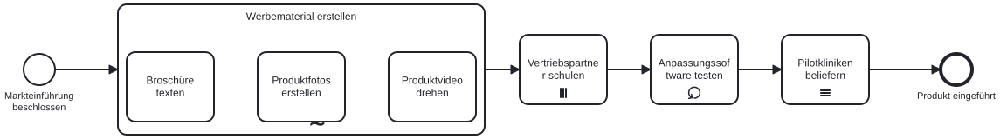

# T1-A3 Markteinführung einer neuen Hörgerätegeneration

Thema 1: Aktivitäten, Fortgeschritten | Zeit: 15 Minuten

## Aufgabe

Ein Hersteller von Hörsystemen führt eine neue Gerätegeneration ein. Nach dem Entscheid zur Markteinführung erstellt das Marketing das Werbematerial: Es textet die Broschüre, erstellt Produktfotos und dreht ein Produktvideo, in beliebiger Reihenfolge und nach Bedarf. Danach schult der Vertrieb alle Vertriebspartner; die Schulungen in den einzelnen Ländern laufen gleichzeitig. Anschliessend testet die Entwicklung die Anpassungssoftware so lange, bis keine Fehler mehr auftreten. Zum Schluss beliefert die Logistik die Pilotkliniken, eine nach der anderen. Damit ist das Produkt eingeführt. Modellieren Sie den Ablauf.

## Lernziel

Ad-hoc-Teilprozess, Schleife sowie parallele und sequenzielle Mehrfachinstanz unterscheiden.

Elemente: task types (user, service, manual, script, business rule, send, receive), subprocess, call activity, ad-hoc subprocess, loop and multi-instance markers (parallel, sequential)

## Musterlösung

BPMN: [solution.de.bpmn](solution.de.bpmn)

## Typische Fehler

- Werbematerial als normaler Teilprozess mit fester Reihenfolge.
- Schulungen als Schleife statt parallele Mehrfachinstanz.
- Software-Test als Mehrfachinstanz statt Schleife (Anzahl Durchläufe ist vorher nicht bekannt).

---
Lizenz: CC BY 4.0
