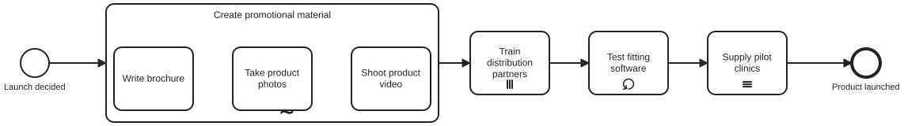

# T1-A3 Launching a new generation of hearing aids

Topic 1: Activities, Advanced | Time: 15 minutes

## Task

A hearing system manufacturer launches a new generation of devices. After the launch decision, marketing creates the promotional material: it writes the brochure, takes product photos and shoots a product video, in any order and as needed. Sales then trains all distribution partners; the trainings in the individual countries run at the same time. Development then tests the fitting software until no more errors occur. Finally logistics supplies the pilot clinics, one after the other. The product is then launched. Model the process.

## Learning goal

Tell an ad-hoc subprocess, a loop and parallel and sequential multi-instance apart.

Elements: task types (user, service, manual, script, business rule, send, receive), subprocess, call activity, ad-hoc subprocess, loop and multi-instance markers (parallel, sequential)

## Sample solution

BPMN: [solution.en.bpmn](solution.en.bpmn)

## Typical mistakes

- Promotional material as an ordinary subprocess with a fixed order.
- Trainings as a loop instead of parallel multi-instance.
- Software test as multi-instance instead of a loop (the number of runs is not known in advance).

---
Licence: CC BY 4.0
