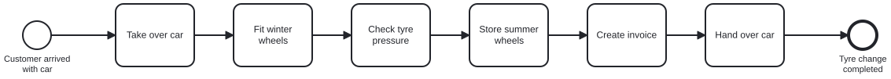

# T1-B Tyre change at a garage

Topic 1: Activities, Basic | Time: 10 minutes, Core exercise

## Task

A garage replaces its customers' summer wheels with winter wheels in autumn. The process starts when a customer arrives with her car for the agreed appointment. The service advisor takes over the car. A mechanic then fits the winter wheels and checks the tyre pressure. After that he puts the summer wheels into wheel storage. Finally the service advisor creates the invoice and hands the car back to the customer. This completes the tyre change. Model the process.

## Learning goal

Model a linear process with start and end event; name activities as object and verb.

Elements: task, sequence flow, start and end event

## Sample solution

BPMN: [solution.en.bpmn](solution.en.bpmn)

## Typical mistakes

- Activities named with a noun only (e.g. "Invoice").
- End event missing or named as an activity.
- Roles (advisor, mechanic) modelled as activities.

---
Licence: CC BY 4.0
