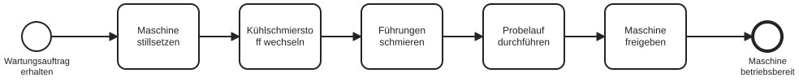

# T1-B3 Wartung einer CNC-Fräsmaschine

Thema 1: Aktivitäten, Grundlagen | Zeit: 10 Minuten

## Aufgabe

Ein Zulieferbetrieb der Uhrenindustrie wartet seine CNC-Fräsmaschinen selbst. Wenn die Instandhaltung einen Wartungsauftrag erhält, setzt eine Technikerin die Maschine still. Sie wechselt den Kühlschmierstoff und schmiert danach die Führungen. Anschliessend lässt sie einen Probelauf laufen und gibt die Maschine danach für die Produktion frei. Der Ablauf endet, wenn die Maschine wieder betriebsbereit ist. Modellieren Sie den Ablauf.

## Lernziel

Einen technischen Ablauf in klar benannte Einzelschritte zerlegen.

Elemente: task, sequence flow, start and end event

## Musterlösung

BPMN: [solution.de.bpmn](solution.de.bpmn)

## Typische Fehler

- Ergebnis als Aktivität statt als Endereignis modelliert ("Maschine betriebsbereit" als Aufgabe).
- Fachbegriffe uneinheitlich benannt ("Maschine stoppen" und "Anlage stillsetzen").
- Startereignis fehlt.

---
Lizenz: CC BY 4.0
