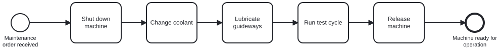

# T1-B3 Maintenance of a CNC milling machine

Topic 1: Activities, Basic | Time: 10 minutes

## Task

A supplier to the watch industry maintains its CNC milling machines itself. When the maintenance team receives a maintenance order, a technician shuts down the machine. She changes the coolant and then lubricates the guideways. After that she runs a test cycle and then releases the machine for production. The process ends when the machine is ready for operation again. Model the process.

## Learning goal

Break a technical procedure into clearly named single steps.

Elements: task, sequence flow, start and end event

## Sample solution

BPMN: [solution.en.bpmn](solution.en.bpmn)

## Typical mistakes

- Result modelled as an activity instead of an end event.
- Inconsistent terms for the same thing ("stop machine", "shut down plant").
- Start event missing.

---
Licence: CC BY 4.0
