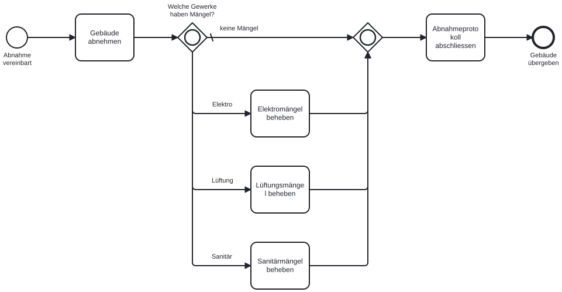

# T2-A Mängel nach der Bauabnahme beheben

Thema 2: Gateways und Parallelität, Fortgeschritten | Zeit: 15 Minuten

## Aufgabe

Ein Anbieter von Gebäudetechnik hat in einem Bürogebäude Elektro-, Lüftungs- und Sanitäranlagen eingebaut. Bei der Abnahme prüft die Bauleiterin das Gebäude. Mängel können bei der Elektrik, der Lüftung und dem Sanitär auftreten, in jeder Kombination. Jedes betroffene Gewerk behebt seine Mängel; die Gewerke arbeiten gleichzeitig. Gibt es keine Mängel, entfällt dieser Schritt. Sobald alle beauftragten Gewerke fertig sind, schliesst die Bauleiterin das Abnahmeprotokoll ab. Damit ist das Gebäude übergeben. Modellieren Sie den Ablauf.

## Lernziel

Eine Auswahl aus mehreren Pfaden mit einem OR-Gateway und einem Standardfluss modellieren und passend zusammenführen.

Elemente: OR, complex gateway, event-based gateway (racing, first event wins), parallel event-based gateway, default flow, conditional flow

## Musterlösung

BPMN: [solution.de.bpmn](solution.de.bpmn)

## Typische Fehler

- XOR-Gateway: nur ein Gewerk könnte Mängel beheben.
- AND-Gateway: alle drei Gewerke würden immer arbeiten.
- OR-Split mit AND- oder XOR-Join geschlossen (Deadlock oder doppelte Ausführung).

---
Lizenz: CC BY 4.0
