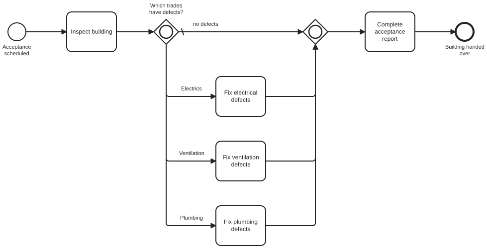

# T2-A Fixing defects after a building inspection

Topic 2: Gateways and parallelism, Advanced | Time: 15 minutes

## Task

A building services provider has installed electrical, ventilation and plumbing systems in an office building. At acceptance, the site manager inspects the building. Defects can occur in the electrics, the ventilation and the plumbing, in any combination. Each affected trade fixes its defects; the trades work at the same time. If there are no defects, this step is skipped. As soon as all commissioned trades are done, the site manager completes the acceptance report. The building is then handed over. Model the process.

## Learning goal

Model a choice of one or more paths with an OR gateway and a default flow, and join it correctly.

Elements: OR, complex gateway, event-based gateway (racing, first event wins), parallel event-based gateway, default flow, conditional flow

## Sample solution

BPMN: [solution.en.bpmn](solution.en.bpmn)

## Typical mistakes

- XOR gateway: only one trade could fix defects.
- AND gateway: all three trades would always work.
- OR split closed with an AND or XOR join (deadlock or duplicate execution).

---
Licence: CC BY 4.0
