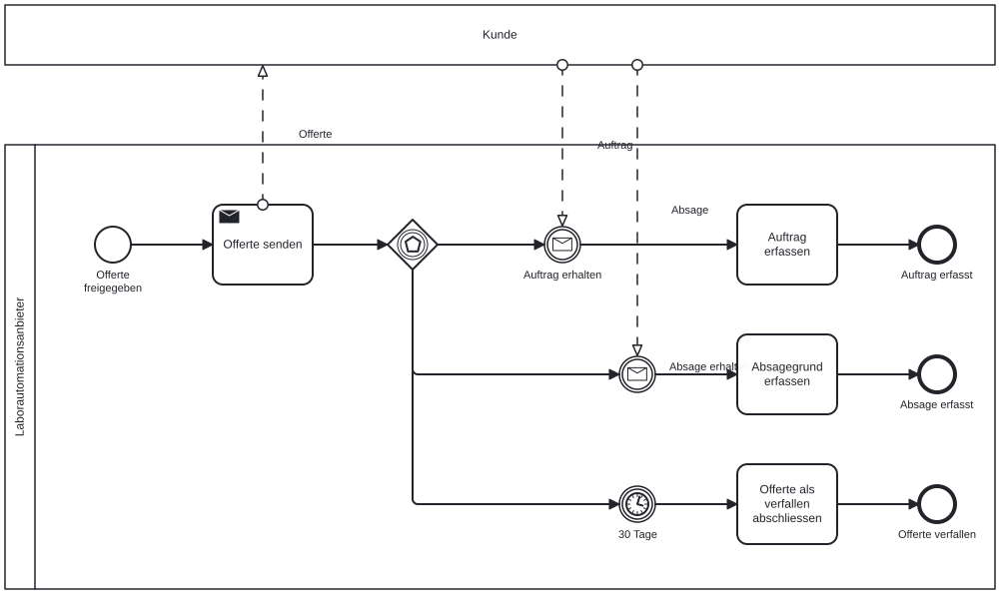

# T2-A2 Auf eine Offerte reagieren

Thema 2: Gateways und Parallelität, Fortgeschritten | Zeit: 15 Minuten

## Aufgabe

Ein Anbieter von Laborautomation sendet einem Kunden eine Offerte für ein Probenhandlingsystem. Danach wartet er auf die Reaktion. Erteilt der Kunde den Auftrag, erfasst der Verkauf den Auftrag. Sagt der Kunde ab, erfasst der Verkauf den Absagegrund. Kommt nach 30 Tagen keine Antwort, schliesst der Verkauf die Offerte als verfallen ab. Es zählt immer das Ereignis, das zuerst eintritt. Modellieren Sie den Ablauf des Anbieters; der Kunde ist ein zugeklappter Pool.

## Lernziel

Mit einem ereignisbasierten Gateway auf das zuerst eintretende Ereignis reagieren.

Elemente: OR, complex gateway, event-based gateway (racing, first event wins), parallel event-based gateway, default flow, conditional flow

## Musterlösung

BPMN: [solution.de.bpmn](solution.de.bpmn)

## Typische Fehler

- XOR-Gateway mit Bedingungen statt ereignisbasiertem Gateway.
- Zeitereignis fehlt, der Ablauf würde ewig warten.
- Gateway beschriftet oder Ausgänge mit ja/nein beschriftet.

---
Lizenz: CC BY 4.0
