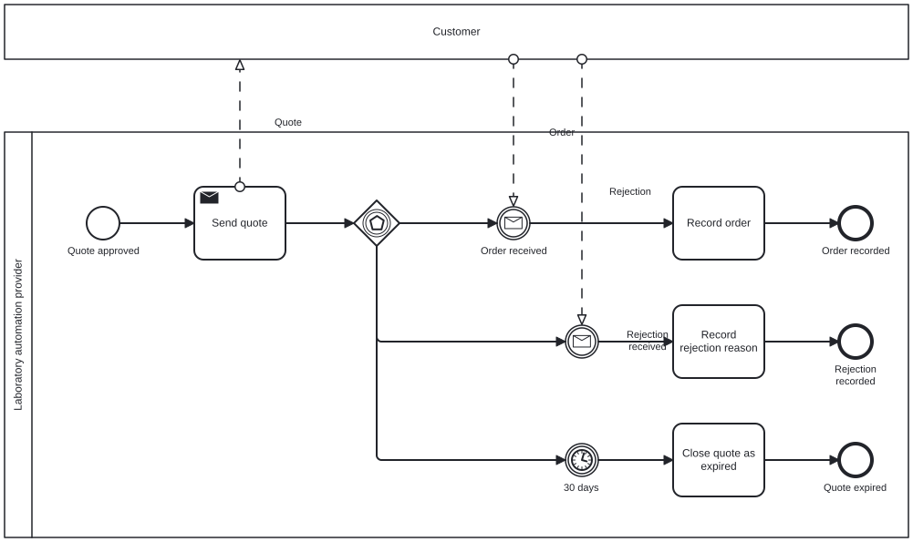

# T2-A2 Reacting to a quote

Topic 2: Gateways and parallelism, Advanced | Time: 15 minutes

## Task

A laboratory automation provider sends a customer a quote for a sample handling system. It then waits for the reaction. If the customer places the order, sales records the order. If the customer declines, sales records the reason. If there is no answer after 30 days, sales closes the quote as expired. Whichever event occurs first counts. Model the provider's process; the customer is a collapsed pool.

## Learning goal

React to the first event that occurs with an event-based gateway.

Elements: OR, complex gateway, event-based gateway (racing, first event wins), parallel event-based gateway, default flow, conditional flow

## Sample solution

BPMN: [solution.en.bpmn](solution.en.bpmn)

## Typical mistakes

- XOR gateway with conditions instead of an event-based gateway.
- Timer event missing, the process would wait forever.
- Gateway labelled or its outgoing flows labelled yes/no.

---
Licence: CC BY 4.0
