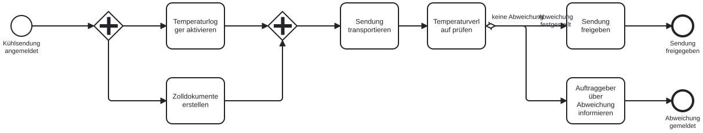

# T2-A3 Kühlkettensendung abwickeln

Thema 2: Gateways und Parallelität, Fortgeschritten | Zeit: 15 Minuten

## Aufgabe

Ein Pharmalogistiker transportiert temperaturempfindliche Medikamente. Ist eine Kühlsendung angemeldet, aktiviert das Lager den Temperaturlogger und gleichzeitig erstellt die Zollabteilung die Zolldokumente. Erst wenn beides erledigt ist, transportiert der Fahrer die Sendung. Am Ziel prüft die Qualitätssicherung den Temperaturverlauf. Wurde eine Abweichung festgestellt, informiert sie den Auftraggeber über die Abweichung; andernfalls gibt sie die Sendung frei. Modellieren Sie den Ablauf. Die Entscheidung nach der Prüfung soll als bedingter Fluss mit Standardfluss direkt aus der Prüfaktivität modelliert werden.

## Lernziel

Parallele Arbeiten synchronisieren und bedingte Flüsse mit einem Standardfluss aus einer Aktivität modellieren.

Elemente: OR, complex gateway, event-based gateway (racing, first event wins), parallel event-based gateway, default flow, conditional flow

## Musterlösung

BPMN: [solution.de.bpmn](solution.de.bpmn)

## Typische Fehler

- Transport startet nach nur einer der beiden Vorbereitungen (XOR-Join statt AND-Join).
- Bedingter Fluss ohne Standardfluss: ohne Abweichung bliebe der Ablauf stehen.
- Beide Ausgänge der Prüfung als bedingte Flüsse mit sich überschneidenden Bedingungen.

---
Lizenz: CC BY 4.0
