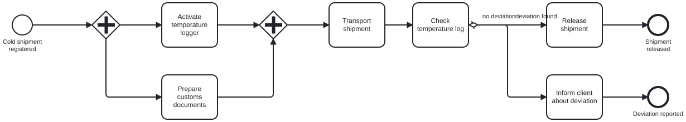

# T2-A3 Handling a cold chain shipment

Topic 2: Gateways and parallelism, Advanced | Time: 15 minutes

## Task

A pharmaceutical logistics company transports temperature-sensitive medicines. When a cold shipment has been registered, the warehouse activates the temperature logger and at the same time the customs department prepares the customs documents. Only when both are done does the driver transport the shipment. At the destination, quality assurance checks the temperature log. If a deviation was found, it informs the client about the deviation; otherwise it releases the shipment. Model the process. Model the decision after the check as a conditional flow with a default flow directly out of the check activity.

## Learning goal

Synchronise parallel work and model conditional flows with a default flow out of an activity.

Elements: OR, complex gateway, event-based gateway (racing, first event wins), parallel event-based gateway, default flow, conditional flow

## Sample solution

BPMN: [solution.en.bpmn](solution.en.bpmn)

## Typical mistakes

- Transport starts after only one of the two preparations (XOR join instead of AND join).
- Conditional flow without a default flow: without a deviation the process would stop.
- Both outputs of the check as conditional flows with overlapping conditions.

---
Licence: CC BY 4.0
