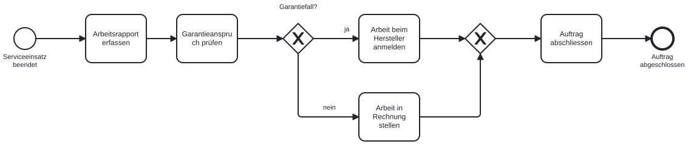

# T2-B Serviceeinsatz an einer Wärmepumpe

Thema 2: Gateways und Parallelität, Grundlagen | Zeit: 10 Minuten, Kernaufgabe

## Aufgabe

Eine Haustechnikfirma wartet Wärmepumpen in Einfamilienhäusern. Nach einem Serviceeinsatz erfasst der Servicetechniker den Arbeitsrapport. Die Disposition prüft danach den Garantieanspruch. Handelt es sich um einen Garantiefall, meldet die Disposition die Arbeit beim Hersteller zur Vergütung an. Andernfalls stellt sie die Arbeit der Kundschaft in Rechnung. In beiden Fällen schliesst die Disposition den Auftrag anschliessend ab. Modellieren Sie den Ablauf.

## Lernziel

Eine exklusive Entscheidung als XOR-Gateway mit Frage und beschrifteten Ausgängen modellieren und wieder zusammenführen.

Elemente: XOR split and merge, AND split and join

## Musterlösung

BPMN: [solution.de.bpmn](solution.de.bpmn)

## Typische Fehler

- AND-Gateway statt XOR-Gateway: beide Wege würden ausgeführt.
- Ausgänge des XOR-Gateways nicht beschriftet.
- Pfade nicht zusammengeführt; "Auftrag abschliessen" doppelt modelliert.

---
Lizenz: CC BY 4.0
