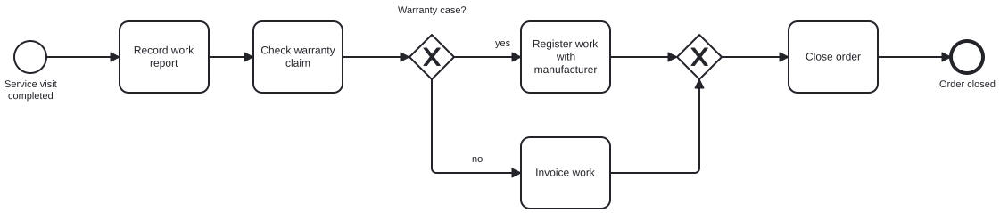

# T2-B Service visit to a heat pump

Topic 2: Gateways and parallelism, Basic | Time: 10 minutes, Core exercise

## Task

A building services company maintains heat pumps in private homes. After a service visit, the service technician records the work report. Dispatch then checks the warranty claim. If it is a warranty case, dispatch registers the work with the manufacturer for reimbursement. Otherwise it invoices the customer. In both cases dispatch then closes the order. Model the process.

## Learning goal

Model an exclusive decision as an XOR gateway with a question and labelled outgoing flows, and merge it again.

Elements: XOR split and merge, AND split and join

## Sample solution

BPMN: [solution.en.bpmn](solution.en.bpmn)

## Typical mistakes

- AND gateway instead of XOR: both paths would run.
- Outgoing flows of the XOR gateway not labelled.
- Paths not merged; "Close order" modelled twice.

---
Licence: CC BY 4.0
