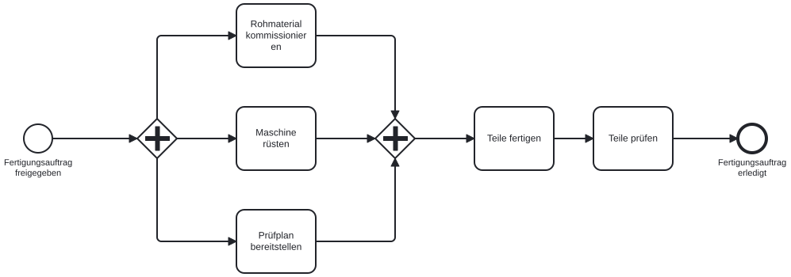

# T2-B2 Fertigungsauftrag vorbereiten

Thema 2: Gateways und Parallelität, Grundlagen | Zeit: 10 Minuten, Kernaufgabe

## Aufgabe

In einem Maschinenbauunternehmen gibt die Arbeitsvorbereitung einen Fertigungsauftrag frei. Danach laufen drei Vorbereitungen gleichzeitig: Das Lager kommissioniert das Rohmaterial, die Werkstatt rüstet die Maschine und die Qualitätssicherung stellt den Prüfplan bereit. Erst wenn alle drei Vorbereitungen erledigt sind, fertigt die Werkstatt die Teile. Danach prüft die Qualitätssicherung die Teile. Damit ist der Fertigungsauftrag erledigt. Modellieren Sie den Ablauf. Rollen müssen nicht dargestellt werden.

## Lernziel

Gleichzeitige Arbeiten mit einem AND-Gateway aufteilen und synchronisieren.

Elemente: XOR split and merge, AND split and join

## Musterlösung

BPMN: [solution.de.bpmn](solution.de.bpmn)

## Typische Fehler

- XOR-Gateway statt AND-Gateway: nur eine Vorbereitung würde ausgeführt.
- Paralleler Pfad ohne AND-Join direkt zu "Teile fertigen" geführt.
- Vorbereitungen hintereinander statt parallel modelliert.

---
Lizenz: CC BY 4.0
