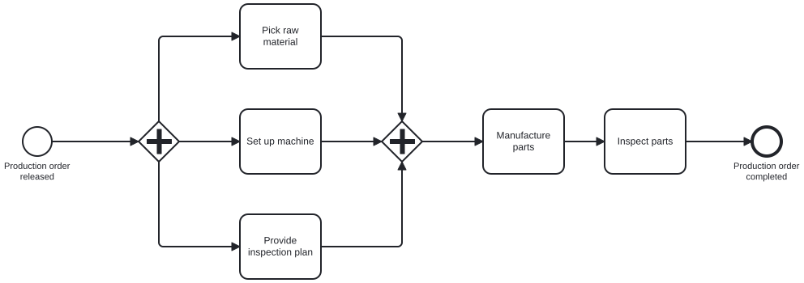

# T2-B2 Preparing a production order

Topic 2: Gateways and parallelism, Basic | Time: 10 minutes, Core exercise

## Task

In an engineering company, production planning releases a production order. Three preparations then run at the same time: the warehouse picks the raw material, the workshop sets up the machine and quality assurance provides the inspection plan. Only when all three preparations are done does the workshop manufacture the parts. Quality assurance then inspects the parts. This completes the production order. Model the process. Roles do not need to be shown.

## Learning goal

Split and synchronise concurrent work with AND gateways.

Elements: XOR split and merge, AND split and join

## Sample solution

BPMN: [solution.en.bpmn](solution.en.bpmn)

## Typical mistakes

- XOR gateway instead of AND: only one preparation would run.
- Parallel paths joined without an AND join.
- Preparations modelled in sequence instead of in parallel.

---
Licence: CC BY 4.0
