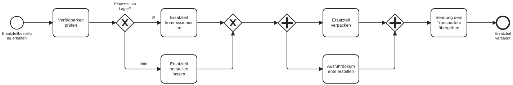

# T2-B3 Ersatzteil ins Ausland liefern

Thema 2: Gateways und Parallelität, Grundlagen | Zeit: 10 Minuten

## Aufgabe

Ein Hersteller von Verpackungsmaschinen erhält eine Bestellung für ein Ersatzteil von einem Kunden im Ausland. Das Lager prüft zuerst die Verfügbarkeit. Ist das Ersatzteil an Lager, kommissioniert das Lager es. Andernfalls lässt das Lager das Ersatzteil in der eigenen Fertigung herstellen. Danach verpackt das Lager das Ersatzteil, während die Exportabteilung gleichzeitig die Ausfuhrdokumente erstellt. Sind beide Arbeiten erledigt, übergibt das Lager die Sendung dem Transporteur. Der Ablauf endet, wenn das Ersatzteil versandt ist. Modellieren Sie den Ablauf.

## Lernziel

XOR und AND im selben Ablauf unterscheiden und jedes Gateway mit dem passenden Gegenstück schliessen.

Elemente: XOR split and merge, AND split and join

## Musterlösung

BPMN: [solution.de.bpmn](solution.de.bpmn)

## Typische Fehler

- XOR-Pfade nicht zusammengeführt, bevor das AND-Gateway öffnet.
- XOR-Gateway mit AND-Gateway geschlossen (oder umgekehrt).
- Ausfuhrdokumente nach dem Verpacken statt parallel dazu modelliert.

---
Lizenz: CC BY 4.0
