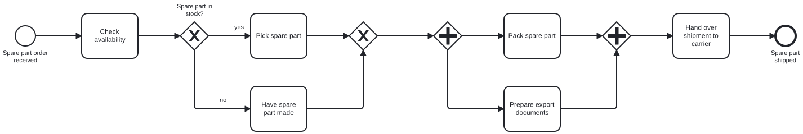

# T2-B3 Shipping a spare part abroad

Topic 2: Gateways and parallelism, Basic | Time: 10 minutes

## Task

A packaging machine manufacturer receives an order for a spare part from a customer abroad. The warehouse first checks availability. If the spare part is in stock, the warehouse picks it. Otherwise the warehouse has the spare part made in the company's own production. The warehouse then packs the spare part while the export department prepares the export documents at the same time. When both are done, the warehouse hands the shipment over to the carrier. The process ends when the spare part has been shipped. Model the process.

## Learning goal

Tell XOR from AND in one process and close every gateway with its matching counterpart.

Elements: XOR split and merge, AND split and join

## Sample solution

BPMN: [solution.en.bpmn](solution.en.bpmn)

## Typical mistakes

- XOR paths not merged before the AND split.
- XOR split closed with an AND join (or the other way round).
- Export documents modelled after packing instead of in parallel.

---
Licence: CC BY 4.0
