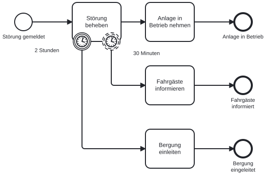

# T3-A Störung an einer Seilbahn

Thema 3: Ereignisse, Fortgeschritten | Zeit: 15 Minuten

## Aufgabe

Ein Seilbahnhersteller betreut eine Pendelbahn. Wird eine Störung gemeldet, behebt ein Servicetechniker die Störung. Dauert die Behebung länger als 30 Minuten, informiert der Betriebsleiter die Fahrgäste über die Verzögerung; die Behebung läuft dabei weiter. Ist die Störung nach 2 Stunden nicht behoben, wird die Behebung abgebrochen und der Betriebsleiter leitet die Bergung der Fahrgäste ein. Wird die Störung rechtzeitig behoben, nimmt der Techniker die Anlage wieder in Betrieb. Modellieren Sie den Ablauf.

## Lernziel

Unterbrechende und nicht unterbrechende Zeit-Randereignisse für Fristen einsetzen.

Elemente: signal, conditional, link, terminate, multiple, parallel multiple; interrupting and non-interrupting boundary events; event subprocess

## Musterlösung

BPMN: [solution.de.bpmn](solution.de.bpmn)

## Typische Fehler

- 30-Minuten-Ereignis unterbrechend: die Behebung würde abgebrochen.
- 2-Stunden-Ereignis nicht unterbrechend: Bergung und Behebung liefen gleichzeitig weiter.
- Fristen als Zeit-Zwischenereignisse nach der Aktivität.

---
Lizenz: CC BY 4.0
