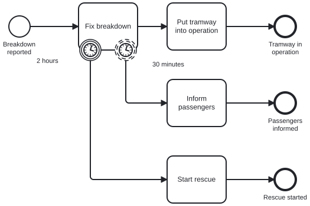

# T3-A Breakdown of a cable car

Topic 3: Events, Advanced | Time: 15 minutes

## Task

A cable car manufacturer services an aerial tramway. When a breakdown is reported, a service technician fixes the breakdown. If fixing takes longer than 30 minutes, the operations manager informs the passengers about the delay; the repair continues. If the breakdown has not been fixed after 2 hours, the repair is stopped and the operations manager starts the rescue of the passengers. If the breakdown is fixed in time, the technician puts the tramway back into operation. Model the process.

## Learning goal

Use interrupting and non-interrupting timer boundary events for time limits.

Elements: signal, conditional, link, terminate, multiple, parallel multiple; interrupting and non-interrupting boundary events; event subprocess

## Sample solution

BPMN: [solution.en.bpmn](solution.en.bpmn)

## Typical mistakes

- 30-minute event interrupting: the repair would be stopped.
- 2-hour event non-interrupting: rescue and repair would run on together.
- Time limits as timer intermediate events after the activity.

---
Licence: CC BY 4.0
