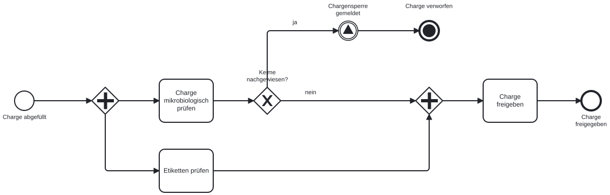

# T3-A2 Charge prüfen und freigeben

Thema 3: Ereignisse, Fortgeschritten | Zeit: 15 Minuten

## Aufgabe

Ein Lebensmittelhersteller füllt Säuglingsnahrung ab. Nach dem Abfüllen einer Charge prüft das Labor die Charge mikrobiologisch, während gleichzeitig die Qualitätssicherung die Etiketten prüft. Werden Keime nachgewiesen, meldet das Labor die Chargensperre an alle Verteillager gleichzeitig, ohne einen bestimmten Empfänger anzusprechen, und verwirft die Charge. Damit wird der gesamte Ablauf sofort beendet, auch eine noch laufende Etikettenprüfung. Sind beide Prüfungen ohne Befund abgeschlossen, gibt die Qualitätssicherung die Charge frei. Modellieren Sie den Ablauf.

## Lernziel

Ein Signal an alle Empfänger senden und mit einem Terminierungs-Endereignis alle laufenden Pfade beenden.

Elemente: signal, conditional, link, terminate, multiple, parallel multiple; interrupting and non-interrupting boundary events; event subprocess

## Musterlösung

BPMN: [solution.de.bpmn](solution.de.bpmn)

## Typische Fehler

- Nachricht an ein Verteillager statt Signal an alle.
- Normales Endereignis: die Etikettenprüfung liefe weiter und das AND-Gateway würde nie fertig.
- AND-Join erhält den Pfad mit Keimbefund ebenfalls.

---
Lizenz: CC BY 4.0
