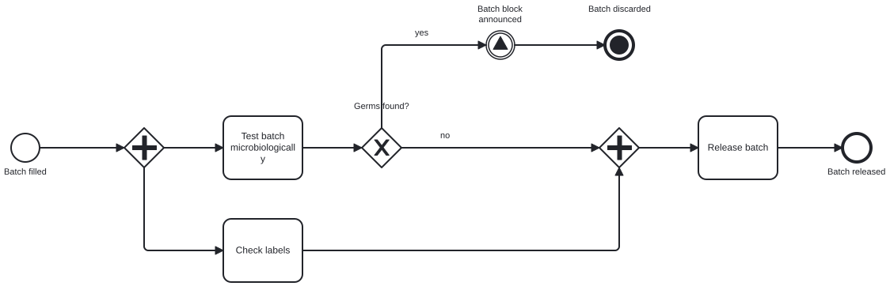

# T3-A2 Testing and releasing a batch

Topic 3: Events, Advanced | Time: 15 minutes

## Task

A food manufacturer fills infant formula. After a batch has been filled, the laboratory tests the batch microbiologically while quality assurance checks the labels at the same time. If germs are found, the laboratory announces the batch block to all distribution warehouses at once, without addressing a particular receiver, and discards the batch. This ends the whole process immediately, including a label check that is still running. If both checks have been completed without findings, quality assurance releases the batch. Model the process.

## Learning goal

Broadcast a signal to all receivers and end all running paths with a terminate end event.

Elements: signal, conditional, link, terminate, multiple, parallel multiple; interrupting and non-interrupting boundary events; event subprocess

## Sample solution

BPMN: [solution.en.bpmn](solution.en.bpmn)

## Typical mistakes

- Message to one warehouse instead of a signal to all.
- None end event: the label check would continue and the AND join would never complete.
- AND join also receives the path with germs found.

---
Licence: CC BY 4.0
