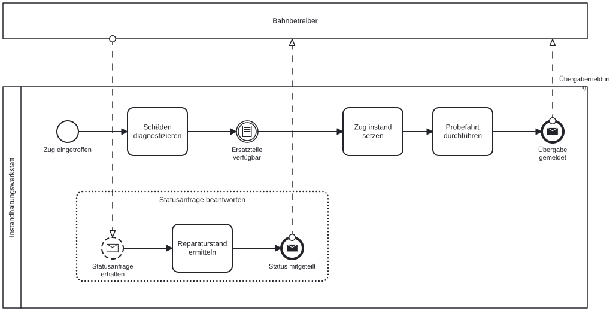

# T3-A3 Instandsetzung eines Triebzugs

Thema 3: Ereignisse, Fortgeschritten | Zeit: 15 Minuten

## Aufgabe

Ein Hersteller von Schienenfahrzeugen setzt in seiner Werkstatt Triebzüge eines Bahnbetreibers instand. Ist ein Zug in der Werkstatt eingetroffen, diagnostiziert ein Techniker die Schäden. Danach wartet die Werkstatt, bis alle benötigten Ersatzteile verfügbar sind. Dann setzt sie den Zug instand und führt eine Probefahrt durch. Zum Schluss meldet sie dem Betreiber die Übergabe. Während der ganzen Instandsetzung kann der Betreiber jederzeit eine Statusanfrage senden; die Werkstatt ermittelt dann den Reparaturstand und teilt ihn mit, ohne die Instandsetzung zu unterbrechen. Modellieren Sie den Ablauf der Werkstatt; der Betreiber ist ein zugeklappter Pool.

## Lernziel

Auf ein Bedingungsereignis warten und Anfragen jederzeit mit einem nicht unterbrechenden Ereignis-Teilprozess beantworten.

Elemente: signal, conditional, link, terminate, multiple, parallel multiple; interrupting and non-interrupting boundary events; event subprocess

## Musterlösung

BPMN: [solution.de.bpmn](solution.de.bpmn)

## Typische Fehler

- Statusanfrage als Teil des Hauptablaufs statt Ereignis-Teilprozess.
- Ereignis-Teilprozess unterbrechend: die Instandsetzung würde abgebrochen.
- Warten auf Ersatzteile als Zeitereignis statt Bedingungsereignis.

---
Lizenz: CC BY 4.0
