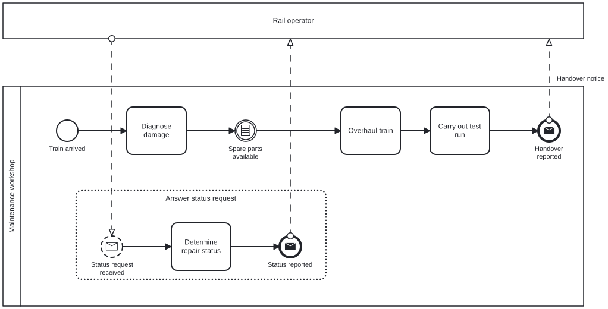

# T3-A3 Overhaul of a train

Topic 3: Events, Advanced | Time: 15 minutes

## Task

A rolling stock manufacturer overhauls a rail operator's trains in its workshop. When a train has arrived at the workshop, a technician diagnoses the damage. The workshop then waits until all required spare parts are available. It then overhauls the train and carries out a test run. Finally it reports the handover to the operator. During the whole overhaul, the operator can send a status request at any time; the workshop then determines the repair status and reports it without interrupting the overhaul. Model the workshop's process; the operator is a collapsed pool.

## Learning goal

Wait for a conditional event and answer requests at any time with a non-interrupting event subprocess.

Elements: signal, conditional, link, terminate, multiple, parallel multiple; interrupting and non-interrupting boundary events; event subprocess

## Sample solution

BPMN: [solution.en.bpmn](solution.en.bpmn)

## Typical mistakes

- Status request as part of the main flow instead of an event subprocess.
- Event subprocess interrupting: the overhaul would be stopped.
- Waiting for spare parts as a timer instead of a conditional event.

---
Licence: CC BY 4.0
