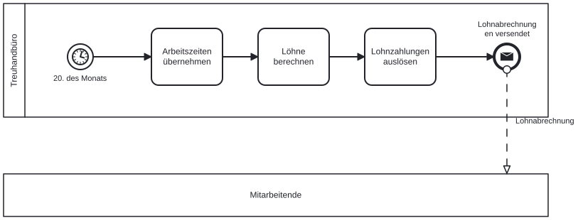

# T3-B Monatliche Lohnabrechnung

Thema 3: Ereignisse, Grundlagen | Zeit: 10 Minuten, Kernaufgabe

## Aufgabe

Ein Treuhandbüro führt die Lohnbuchhaltung für ein Gewerbeunternehmen. Am 20. jedes Monats übernimmt die Lohnbuchhalterin die erfassten Arbeitszeiten, berechnet die Löhne und löst die Lohnzahlungen aus. Zum Schluss versendet das Treuhandbüro die Lohnabrechnungen an die Mitarbeitenden. Modellieren Sie den Ablauf des Treuhandbüros in einem Pool und die Mitarbeitenden als zugeklappten Pool.

## Lernziel

Einen zeitgesteuerten Start und ein sendendes Nachrichten-Endereignis modellieren.

Elemente: none, message and timer events (start, intermediate, end), throw vs catch

## Musterlösung

BPMN: [solution.de.bpmn](solution.de.bpmn)

## Typische Fehler

- Normales Startereignis statt Zeit-Startereignis.
- Zeit-Startereignis ohne Zeitregel beschriftet ("Start").
- Versand als empfangendes statt sendendes Ereignis oder ohne Nachrichtenfluss modelliert.

---
Lizenz: CC BY 4.0
