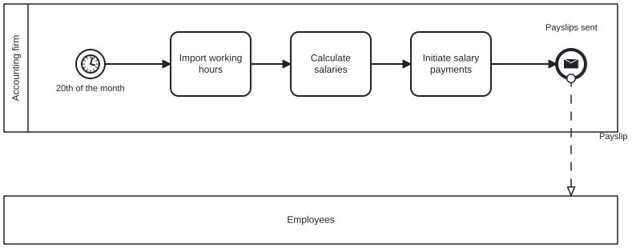

# T3-B Monthly payroll

Topic 3: Events, Basic | Time: 10 minutes, Core exercise

## Task

An accounting firm runs payroll for a small business. On the 20th of every month the payroll accountant imports the recorded working hours, calculates the salaries and initiates the salary payments. Finally the accounting firm sends the payslips to the employees. Model the accounting firm's process in a pool and the employees as a collapsed pool.

## Learning goal

Model a timer start and a throwing message end event.

Elements: none, message and timer events (start, intermediate, end), throw vs catch

## Sample solution

BPMN: [solution.en.bpmn](solution.en.bpmn)

## Typical mistakes

- None start event instead of a timer start event.
- Timer start event labelled without the time rule ("Start").
- Sending modelled as a catching event or without message flow.

---
Licence: CC BY 4.0
