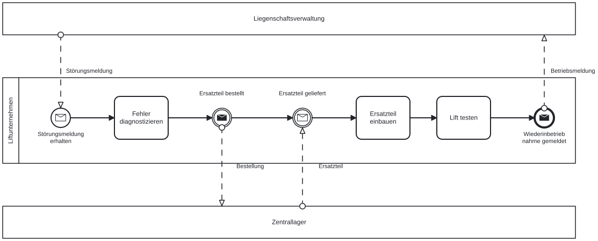

# T3-B2 Störung an einem Lift beheben

Thema 3: Ereignisse, Grundlagen | Zeit: 10 Minuten, Kernaufgabe

## Aufgabe

Die Leitstelle eines Liftunternehmens erhält eine Störungsmeldung von einer Liegenschaftsverwaltung. Ein Servicetechniker diagnostiziert den Fehler vor Ort und bestellt das nötige Ersatzteil beim Zentrallager. Er wartet, bis das Zentrallager das Ersatzteil geliefert hat. Dann baut er das Ersatzteil ein und testet den Lift. Zum Schluss meldet das Liftunternehmen der Liegenschaftsverwaltung, dass der Lift wieder in Betrieb ist. Modellieren Sie den Ablauf des Liftunternehmens in einem Pool. Liegenschaftsverwaltung und Zentrallager sind zugeklappte Pools.

## Lernziel

Senden und Empfangen von Nachrichten mit Start-, Zwischen- und Endereignissen unterscheiden; Warten als Ereignis modellieren.

Elemente: none, message and timer events (start, intermediate, end), throw vs catch

## Musterlösung

BPMN: [solution.de.bpmn](solution.de.bpmn)

## Typische Fehler

- Warten als Aktivität ("Auf Ersatzteil warten") statt als empfangendes Zwischenereignis.
- Bestellung als empfangendes statt sendendes Ereignis.
- Sequenzfluss statt Nachrichtenfluss zwischen den Pools.

---
Lizenz: CC BY 4.0
