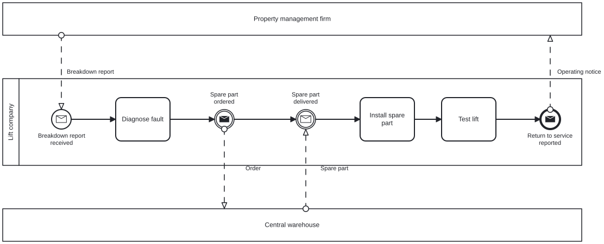

# T3-B2 Fixing a lift breakdown

Topic 3: Events, Basic | Time: 10 minutes, Core exercise

## Task

The control centre of a lift company receives a breakdown report from a property management firm. A service technician diagnoses the fault on site and orders the required spare part from the central warehouse. He waits until the central warehouse has delivered the spare part. He then installs the spare part and tests the lift. Finally the lift company tells the property management firm that the lift is back in operation. Model the lift company's process in a pool. The property management firm and the central warehouse are collapsed pools.

## Learning goal

Tell sending from receiving with start, intermediate and end events; model waiting as an event.

Elements: none, message and timer events (start, intermediate, end), throw vs catch

## Sample solution

BPMN: [solution.en.bpmn](solution.en.bpmn)

## Typical mistakes

- Waiting modelled as an activity instead of a catching intermediate event.
- Ordering modelled as a catching instead of a throwing event.
- Sequence flow instead of message flow between pools.

---
Licence: CC BY 4.0
