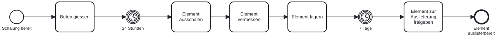

# T3-B3 Betonfertigteile herstellen

Thema 3: Ereignisse, Grundlagen | Zeit: 10 Minuten

## Aufgabe

Ein Betonwerk stellt Treppenelemente her. Sobald die Schalung bereit ist, giesst ein Mitarbeiter den Beton. Danach muss der Beton 24 Stunden in der Schalung aushärten. Anschliessend schalt der Mitarbeiter das Element aus und vermisst es. Das Element wird dann auf dem Lagerplatz gelagert. Nach 7 Tagen gibt die Qualitätssicherung das Element für die Auslieferung frei. Der Ablauf endet, wenn das Element auslieferbereit ist. Modellieren Sie den Ablauf.

## Lernziel

Wartezeiten als Zeit-Zwischenereignisse mit der Zeitregel als Beschriftung modellieren.

Elemente: none, message and timer events (start, intermediate, end), throw vs catch

## Musterlösung

BPMN: [solution.de.bpmn](solution.de.bpmn)

## Typische Fehler

- Wartezeit als Aktivität ("Beton aushärten lassen") statt als Zeit-Zwischenereignis.
- Zeitereignis ohne Dauer beschriftet.
- Zeit-Startereignis statt normalem Startereignis verwendet.

---
Lizenz: CC BY 4.0
