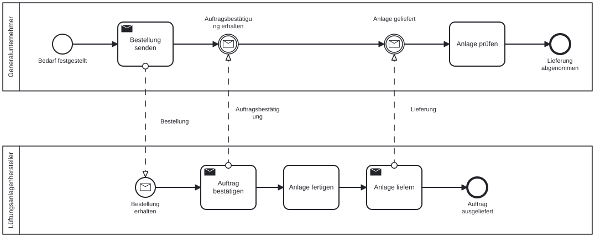

# T4-A Lüftungsanlage bestellen und liefern

Thema 4: Kollaboration, Fortgeschritten | Zeit: 15 Minuten

## Aufgabe

Ein Generalunternehmer braucht für einen Neubau eine Lüftungsanlage. Stellt die Bauleitung den Bedarf fest, sendet der Einkauf eine Bestellung an einen Hersteller von Lüftungsanlagen und wartet auf die Auftragsbestätigung. Der Hersteller bestätigt den Auftrag, fertigt die Anlage und liefert sie. Nach der Lieferung prüft die Bauleitung die Anlage, und die Lieferung ist abgenommen. Modellieren Sie die Abläufe beider Unternehmen in je einem aufgeklappten Pool.

## Lernziel

Zwei Beteiligte in zwei aufgeklappten Pools modellieren und nur über Nachrichtenflüsse verbinden.

Elemente: several pools, message flow, black-box pool, multi-instance pool

## Musterlösung

BPMN: [solution.de.bpmn](solution.de.bpmn)

## Typische Fehler

- Sequenzfluss zwischen den Pools.
- Beide Unternehmen als Lanes eines Pools.
- Warten auf die Bestätigung fehlt beim Generalunternehmer.

---
Lizenz: CC BY 4.0
