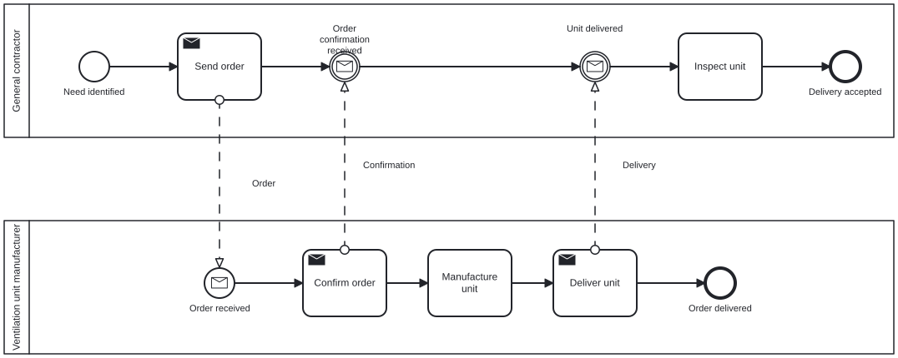

# T4-A Ordering and delivering a ventilation unit

Topic 4: Collaboration, Advanced | Time: 15 minutes

## Task

A general contractor needs a ventilation unit for a new building. When site management identifies the need, purchasing sends an order to a ventilation unit manufacturer and waits for the order confirmation. The manufacturer confirms the order, manufactures the unit and delivers it. After delivery, site management inspects the unit, and the delivery is accepted. Model the processes of both companies in one expanded pool each.

## Learning goal

Model two participants in two expanded pools and connect them only by message flows.

Elements: several pools, message flow, black-box pool, multi-instance pool

## Sample solution

BPMN: [solution.en.bpmn](solution.en.bpmn)

## Typical mistakes

- Sequence flow between the pools.
- Both companies as lanes of one pool.
- Waiting for the confirmation missing at the general contractor.

---
Licence: CC BY 4.0
