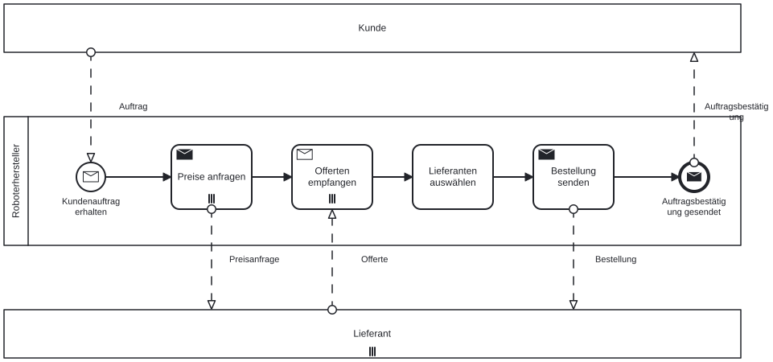

# T4-A2 Komponenten bei mehreren Lieferanten anfragen

Thema 4: Kollaboration, Fortgeschritten | Zeit: 15 Minuten

## Aufgabe

Ein Hersteller von Industrierobotern erhält von einem Kunden den Auftrag für eine Roboterzelle. Für die Greifer fragt der Einkauf gleichzeitig bei mehreren Lieferanten (mindestens drei) Preise an und empfängt deren Offerten. Danach wählt er einen Lieferanten aus und sendet ihm die Bestellung. Zum Schluss sendet der Hersteller dem Kunden die Auftragsbestätigung. Modellieren Sie den Ablauf des Herstellers; Kunde und Lieferanten sind zugeklappte Pools.

## Lernziel

Mehrere Partner desselben Typs mit einem Mehrfachinstanz-Pool und mehrfach ausgeführten Sende- und Empfangsaufgaben modellieren.

Elemente: several pools, message flow, black-box pool, multi-instance pool

## Musterlösung

BPMN: [solution.de.bpmn](solution.de.bpmn)

## Typische Fehler

- Ein Pool pro Lieferant statt Mehrfachinstanz-Pool.
- Anfragen als Schleife statt parallele Mehrfachinstanz.
- Lieferanten als Lanes im eigenen Pool.

---
Lizenz: CC BY 4.0
