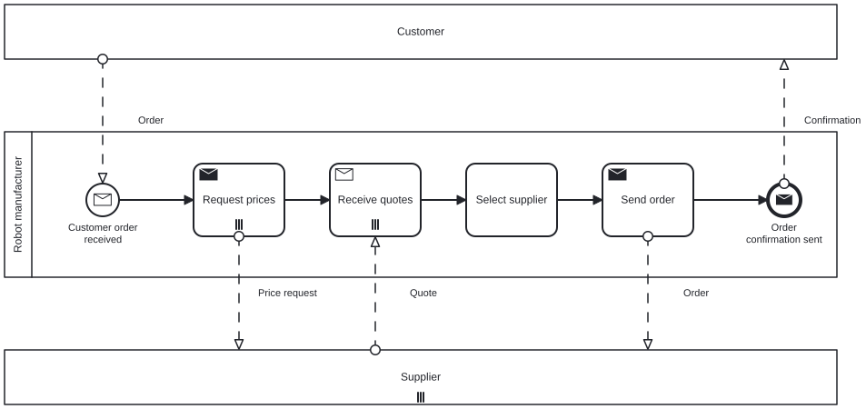

# T4-A2 Requesting components from several suppliers

Topic 4: Collaboration, Advanced | Time: 15 minutes

## Task

An industrial robot manufacturer receives an order for a robot cell from a customer. For the grippers, purchasing asks several suppliers (at least three) for prices at the same time and receives their quotes. It then selects a supplier and sends the order to it. Finally the manufacturer sends the order confirmation to the customer. Model the manufacturer's process; the customer and the suppliers are collapsed pools.

## Learning goal

Model several partners of the same type with a multi-instance pool and multi-instance send and receive tasks.

Elements: several pools, message flow, black-box pool, multi-instance pool

## Sample solution

BPMN: [solution.en.bpmn](solution.en.bpmn)

## Typical mistakes

- One pool per supplier instead of a multi-instance pool.
- Requests as a loop instead of parallel multi-instance.
- Suppliers as lanes in the own pool.

---
Licence: CC BY 4.0
