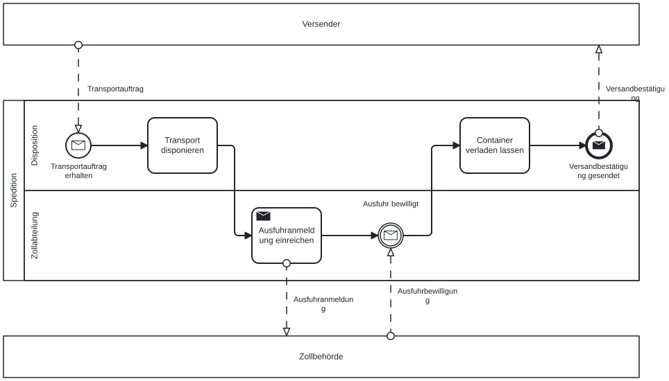

# T4-A3 Seefracht exportieren

Thema 4: Kollaboration, Fortgeschritten | Zeit: 15 Minuten

## Aufgabe

Eine Spedition organisiert Seefracht für Versender. Erhält die Disposition einen Transportauftrag von einem Versender, disponiert sie den Transport. Danach reicht die Zollabteilung die Ausfuhranmeldung bei der Zollbehörde ein und wartet auf die Ausfuhrbewilligung. Ist die Ausfuhr bewilligt, lässt die Disposition den Container verladen und sendet dem Versender die Versandbestätigung. Modellieren Sie den Ablauf der Spedition mit Lanes für Disposition und Zollabteilung; Versender und Zollbehörde sind zugeklappte Pools.

## Lernziel

Den eigenen Ablauf mit Lanes von externen Partnern als zugeklappte Pools trennen.

Elemente: several pools, message flow, black-box pool, multi-instance pool

## Musterlösung

BPMN: [solution.de.bpmn](solution.de.bpmn)

## Typische Fehler

- Zollbehörde als Lane der Spedition.
- Nachrichtenfluss zwischen den Lanes der Spedition.
- Warten auf die Bewilligung fehlt.

---
Lizenz: CC BY 4.0
