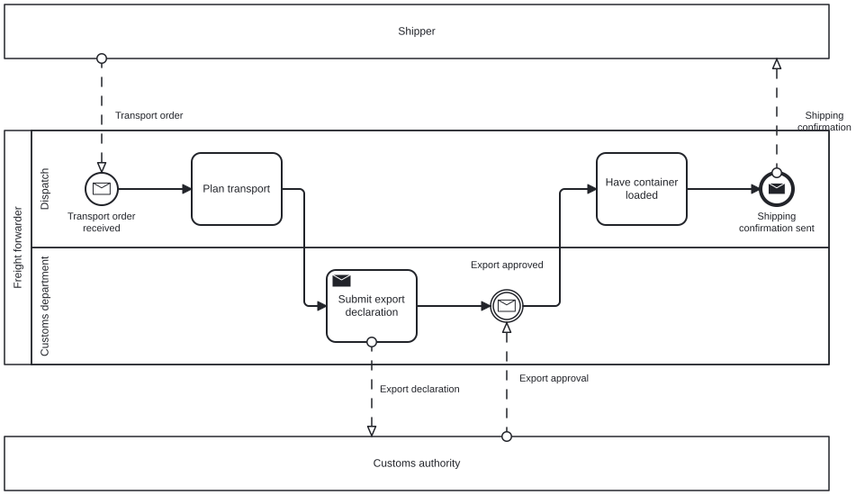

# T4-A3 Exporting sea freight

Topic 4: Collaboration, Advanced | Time: 15 minutes

## Task

A freight forwarder organises sea freight for shippers. When dispatch receives a transport order from a shipper, it plans the transport. The customs department then submits the export declaration to the customs authority and waits for the export approval. Once the export is approved, dispatch has the container loaded and sends the shipping confirmation to the shipper. Model the forwarder's process with lanes for dispatch and customs department; the shipper and the customs authority are collapsed pools.

## Learning goal

Separate the own process with lanes from external partners as collapsed pools.

Elements: several pools, message flow, black-box pool, multi-instance pool

## Sample solution

BPMN: [solution.en.bpmn](solution.en.bpmn)

## Typical mistakes

- Customs authority as a lane of the forwarder.
- Message flow between the forwarder's lanes.
- Waiting for the approval missing.

---
Licence: CC BY 4.0
